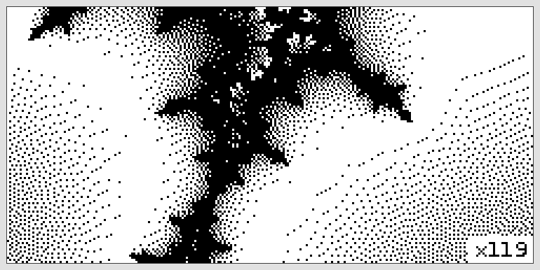
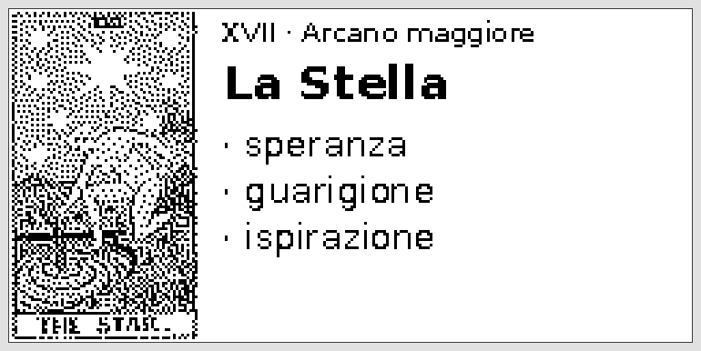
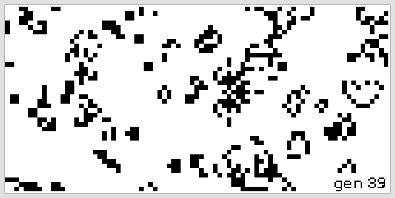
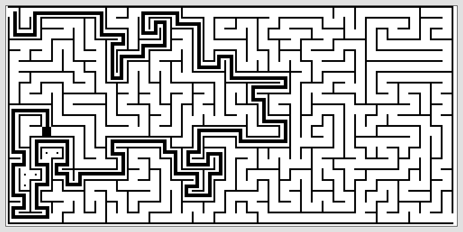
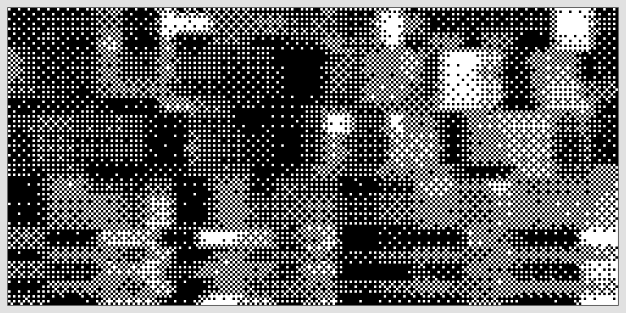
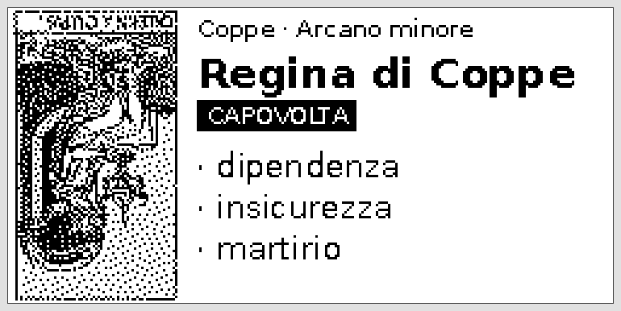

# Etere: un gadget e-paper con più anime

Un Raspberry Pi Zero W con display e-paper Waveshare 2.13" (V3) che mostra
cose diverse a seconda dell'app scelta. All'accensione parte l'app
predefinita. Dal telefono, collegato alla rete del gadget, si apre una
paginetta per cambiare app e impostazioni.

Le app lente (frattale, tarocchi, foto, etere) fanno un refresh completo e
poi mettono il pannello a dormire. Quelle veloci (vita, labirinto) usano il
**refresh parziale**: circa 0,3 secondi, senza lampeggio, con un refresh
completo ogni 30 aggiornamenti per cancellare gli aloni. Puoi staccare la
corrente in qualsiasi momento **tranne durante un aggiornamento**: l'ultima
immagine resta sull'e-paper finché non lo riaccendi.

| | |
|---|---|
|  |  |
| **Viaggio nel frattale** | **Tarocchi** |
|  |  |
| **Gioco della vita** | **Labirinto** |
|  |  |
| **Etere** (onde Wi-Fi) | **Tarocchi**, carta capovolta |

*Le immagini sono generate con lo stesso codice che gira sul Pi
(`python3 tools/gallery.py`), alla risoluzione reale del display ingrandita
3 volte.*

## Le app

| App | Cosa fa |
|---|---|
| `mandelbrot` (predefinita) | **Viaggio nel frattale.** Ogni minuto (o appena pronto, se il calcolo dura di più) scende più in profondità nell'insieme di Mandelbrot, fino a ingrandimenti di centinaia di miliardi. Un "pilota automatico" sceglie a ogni passo un punto sul bordo del frattale, quindi ogni accensione è un viaggio diverso. Stili: `incisione`, `china`, `chiaroscuro`. |
| `tarocchi` | **Tarocchi.** Mazzo completo di 78 carte (22 arcani maggiori e 56 minori). Ogni 30 secondi estrae una carta a caso, dritta o capovolta, e mostra il disegno originale con nome e parole chiave in italiano. |
| `vita` | **Gioco della vita.** Ogni 5 secondi una generazione del gioco di Conway, su un mondo che si richiude su se stesso. Quando si stabilizza (tutto fermo o figure che si ripetono) mostra ancora qualche passo e riparte da una disposizione casuale. Dopo 1000 generazioni riparte comunque. |
| `labirinto` | **Labirinto.** Genera un labirinto e un topolino lo esplora a passi di 12 celle ogni 5 secondi, tornando indietro dai vicoli ciechi: la linea è il cammino attuale, i puntini i tratti abbandonati. Trovata l'uscita, ne genera un altro. |
| `foto` | **Foto.** Mostra l'ultima foto caricata dalla pagina di controllo, trasformata in bianco e nero. Si salva solo la versione finale da pochi KB (`etere-foto.png` accanto a `etere.conf`), che sostituisce sempre la precedente; l'originale non viene mai scritto su disco. |
| `etere` | **Etere.** Il ritratto delle reti Wi-Fi intorno al gadget: si vedono soprattutto i cambiamenti, per esempio qualcuno che passa. Non funziona mentre il gadget crea la sua rete, perché la radio è occupata. |

Le estrazioni casuali usano il generatore casuale del sistema. A parte la
foto caricata, nessuna app salva nulla: tutto vive solo sullo schermo.

Per aggiungere un'app: un modulo in `etere/apps/` con `name`, `title`,
`frame()` (che ritorna un'immagine 1-bit 250×122 e i secondi di attesa) e
`close()`, registrato in `etere/apps/__init__.py`.

## La rete del gadget e la pagina di controllo

All'accensione il gadget cerca le reti che conosce (per esempio l'hotspot del
telefono configurato con Raspberry Pi Imager):

- **se la trova**, si collega: puoi entrare via SSH e aggiornare da GitHub;
- **se non la trova entro 45 secondi**, crea la sua rete **`raspberry`**
  (password predefinita `raspberrypi`).

Collegati a `raspberry` dal telefono: la pagina di controllo si apre da sola,
come il "login" delle reti degli alberghi. Se non si apre, vai su
**http://10.42.0.1**. Da lì puoi:

- mostrare subito un'app;
- scegliere l'app da usare all'accensione;
- caricare una foto dal telefono: diventa in bianco e nero e va subito sullo schermo;
- cambiare intervalli, stile del frattale e carte capovolte.

Se nella finestrina che si apre da sola il pulsante per scegliere la foto non
funziona, chiudila scegliendo di restare collegato senza internet e apri
http://10.42.0.1 nel browser.

Su quella rete non c'è internet: il telefono potrebbe avvisarti, è normale.
Funziona anche l'SSH: `ssh <utente>@10.42.0.1`.

> **Sicurezza:** il repo è pubblico, quindi la password predefinita della rete
> la conosce chiunque lo legga. Cambia `AP_PASSWORD` in `etere.conf` (almeno 8
> caratteri), rilancia `install.sh`, e cambia anche la password dell'utente
> con `passwd`.

## Hardware

- **Raspberry Pi Zero W** (v1.1, chip Wi-Fi bcm43430a1, solo 2,4 GHz)
- **Waveshare 2.13" e-Paper HAT** (Rev 2.1, pannello V3): 250×122 pixel,
  bianco e nero, si innesta direttamente sui 40 pin
- una microSD da 8 GB o più
- alimentazione micro-USB: caricatore o powerbank

Niente saldature: il display si innesta sul Pi. Con un pannello V2 o V4 basta
cambiare `EPD=` nella configurazione.

## Installazione

### 1. Scrivi la SD

Con **Raspberry Pi Imager**: dispositivo *Raspberry Pi Zero*, sistema
**Raspberry Pi OS Lite (32-bit)**. Nelle impostazioni: hostname, utente e
password, SSH attivo, Wi-Fi (o l'hotspot del telefono) con paese `IT`.

> Il Pi Zero W usa solo i **2,4 GHz**. Con l'hotspot di un iPhone attiva
> *Impostazioni → Hotspot personale → Massimizza compatibilità*.

### 2. Installa

```bash
sudo apt-get install -y git
git clone https://github.com/raxp122/e-paper-gadget.git
cd e-paper-gadget
sudo ./install/install.sh
```

Lo script installa le dipendenze, attiva lo SPI, scarica il driver Waveshare e
le 78 carte, copia il programma in `/opt/etere`, crea la configurazione
`/boot/firmware/etere.conf`, prepara la rete `raspberry` e abilita l'avvio
automatico.

### 3. Prova e avvia

```bash
sudo python3 /opt/etere/etere.py --test-display
sudo systemctl restart etere
journalctl -u etere -f
```

Se il display resta bianco, cambia `EPD=` in `/boot/firmware/etere.conf`
(V2, V3 o V4, come sull'etichetta dietro il display).

### Aggiornare

Accendi l'hotspot del telefono, riavvia il gadget, entra via SSH e:

```bash
cd ~/e-paper-gadget && git pull && sudo ./install/install.sh && sudo systemctl restart etere
```

### Renderlo effimero (sola lettura)

Quando tutto funziona, `sudo ./install/readonly.sh` mette il sistema in sola
lettura: staccare la corrente non può più rovinare la SD. Le scelte fatte
dalla pagina di controllo vengono comunque salvate, perché `etere.conf` sta
sulla partizione di boot, che viene riaperta in scrittura solo per un attimo.

Per tornare indietro:

```bash
sudo raspi-config nonint disable_overlayfs && sudo reboot
```

poi, dopo il riavvio:

```bash
sudo raspi-config nonint disable_bootro && sudo reboot
```

## Configurazione (`etere.conf`)

Il file sta nella partizione di boot: si modifica anche dal PC con un lettore
di SD. Quasi tutto si cambia anche dalla pagina di controllo.

| Chiave | Default | Significato |
|---|---|---|
| `APP` | `mandelbrot` | app all'accensione: `mandelbrot`, `tarocchi`, `vita`, `labirinto`, `foto`, `etere` |
| `MANDEL_SECONDS` | `60` | secondi tra un passo e l'altro (se il calcolo dura di più, il passo arriva appena pronto) |
| `MANDEL_STYLE` | `incisione` | `incisione`, `china`, `chiaroscuro` |
| `MANDEL_ZOOM_LABEL` | `1` | mostra l'ingrandimento nell'angolo |
| `TAROT_SECONDS` | `30` | secondi tra una carta e l'altra |
| `TAROT_REVERSED` | `1` | le carte possono uscire capovolte |
| `LIFE_SECONDS` | `5` | secondi tra una generazione e l'altra |
| `LIFE_DENSITY` | `0.3` | quota di celle vive alla partenza |
| `MAZE_SECONDS` / `MAZE_STEPS` | `5` / `12` | ogni quanto e di quante celle avanza il topolino |
| `EPD_FULL_EVERY` | `30` | con il refresh parziale, uno completo ogni tanti aggiornamenti |
| `AP_SSID` / `AP_PASSWORD` | `raspberry` / `raspberrypi` | rete del gadget (dopo una modifica rilancia `install.sh`) |
| `WEB_PORT` | `80` | porta della pagina di controllo |
| `AP_FALLBACK_SECONDS` | `45` | quanto aspettare una rete conosciuta prima di accendere la propria |
| `EPD` | `V3` | versione del pannello: V2, V3, V4 |
| `ROTATE` | `0` | 180 se il display è montato capovolto |

Per l'app `etere`:

| Chiave | Default | Significato |
|---|---|---|
| `SOURCE` | `auto` | `auto`, `csi`, `rssi`, `scan` (vedi sotto) |
| `VIEW` | `intensita` | `spettro`, `variazioni`, `intensita`, `mix` |
| `DITHER` | `bayer` | `floyd` (morbido) o `bayer` (a reticolo) |
| `EXPOSURE_SECONDS` | `10` | secondi di ascolto tra uno scatto e l'altro |
| `CLEAN` | `0.6` | 0 = immagine grezza, 1 = molto pulita |
| `KEEP_WIFI` | `1` | 0 = il gadget si prende la radio (niente SSH) |

**Modalità manutenzione:** un file vuoto chiamato `etere-off` nella
partizione di boot impedisce al programma di partire.

### Le sorgenti radio di Etere

| Sorgente | Cosa misura | Sul Pi Zero W |
|---|---|---|
| `csi` | Channel State Information | Non supportata (Nexmon CSI non ha la patch per il chip bcm43430a1) |
| `rssi` | modalità monitor su un canale | Serve Nexmon, che supporta solo kernel fino al 6.6 (`install/install-nexmon.sh`, sperimentale) |
| `scan` | scansioni Wi-Fi normali | Funziona sempre |

Nessuna sorgente legge o conserva indirizzi MAC, nomi di rete o contenuti.

## Problemi frequenti

| Problema | Soluzione |
|---|---|
| Lo schermo resta bianco | Prova `EPD=V2` o `EPD=V4` in `etere.conf`, poi `--test-display`. Controlla che il HAT sia inserito su tutti i 40 pin. |
| Il Pi non si collega all'hotspot dell'iPhone | Attiva *Massimizza compatibilità*: il Pi Zero W vede solo i 2,4 GHz. |
| SSH risponde "Connection refused" | Al primo avvio aspetta 3-5 minuti. Se non basta, crea un file vuoto `ssh` nella partizione `bootfs`. |
| `apt` si interrompe a metà download | Succede con gli hotspot: rilancia `install.sh`, riparte da dove si era fermato. |
| La rete `raspberry` non compare | All'avvio il gadget aspetta 45 secondi una rete conosciuta (`AP_FALLBACK_SECONDS`), poi accende la sua: aspetta circa un minuto e mezzo dall'accensione. Per accenderla subito: `sudo nmcli connection up etere-ap`. Dopo aver cambiato `AP_SSID` o `AP_PASSWORD` rilancia `install.sh`. |
| La pagina non si apre da sola | Apri `http://10.42.0.1` nel browser. Su iPhone, se nella finestrina non riesci a scegliere una foto, chiudila scegliendo di restare collegato senza internet e usa Safari. |
| Etere dice "la radio non è disponibile" | Con la rete `raspberry` attiva la radio è occupata: collega il gadget all'hotspot. |
| Dopo un aggiornamento non cambia nulla | Serve `sudo systemctl restart etere`, oppure stacca e riattacca. |

## Sviluppo sul PC

```bash
python3 -m unittest discover tests
python3 etere/etere.py --app mandelbrot --once --out frame.png
python3 etere/etere.py --app tarocchi --out frame.png --web-port 8080
```

L'ultimo comando apre anche la pagina di controllo su http://localhost:8080.
Le immagini delle carte non sono nel repo: senza, compare un segnaposto.

```bash
python3 tools/preview.py anteprima.png   # anteprima delle sorgenti di Etere
python3 tools/gallery.py                 # rigenera le immagini del README
```

## Struttura del progetto

```
etere/
  etere.py        programma principale: app, display, pagina web
  config.py       lettura e salvataggio di etere.conf
  display.py      pannello Waveshare (completo / parziale) o PNG
  render.py       dalla matrice all'immagine 1-bit (viste, dithering)
  web.py          pagina di controllo per il telefono
  sources.py      sorgenti radio di Etere (csi, rssi, scan, sim)
  radiotap.py     lettura della potenza dei frame in modalità monitor
  apps/           mandelbrot, tarocchi, vita, labirinto, foto, radio (etere)
  data/           nomi e significati dei tarocchi
install/
  install.sh      installazione e aggiornamento
  etere.conf      configurazione predefinita
  etere.service   avvio automatico (systemd)
  readonly.sh     sistema in sola lettura
  install-nexmon.sh  modalità monitor (sperimentale)
tests/            test automatici (python3 -m unittest discover tests)
tools/            anteprime e immagini del README
docs/img/         immagini del README
```


## Crediti

- Carte dei tarocchi: mazzo **Rider-Waite-Smith** (1909), illustrato da Pamela
  Colman Smith, pubblico dominio. Scansioni dal progetto
  [metabismuth/tarot-json](https://github.com/metabismuth/tarot-json).
  Nomi e parole chiave in italiano scritti per questo progetto.
- Display: libreria [Waveshare e-Paper](https://github.com/waveshare/e-Paper)
- Modalità monitor / CSI: [Nexmon](https://nexmon.org) e
  [Nexmon CSI](https://github.com/seemoo-lab/nexmon_csi) di SEEMOO Lab, TU Darmstadt

## Licenza

Codice sotto licenza [MIT](LICENSE). Le scansioni delle carte Rider-Waite-Smith
sono di pubblico dominio e non sono incluse nel repo: le scarica
`install.sh`.
